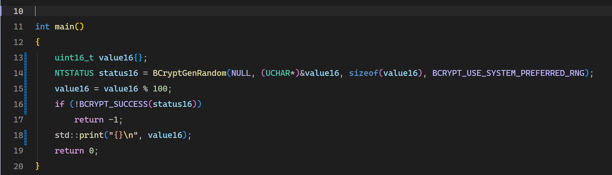
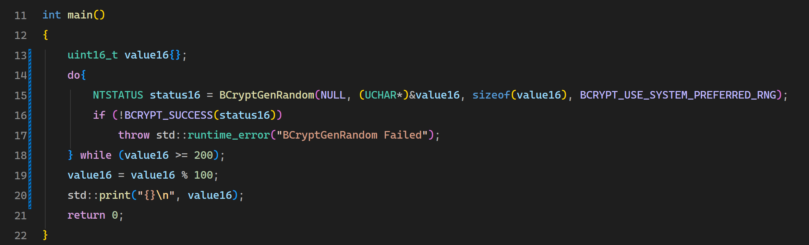

## 1. CNG

Cryptography Next Generation(CNG)


主要提供下面功能；

- Hash
- Symmetric Encryption
- Asymmetric Cryptography
- Digital Signature
- Random Number
- Key Management


## 2. Random Number

下面代码生成 32位和64位随机数.

使用到的API:

- BCryptGenRandom

```cpp
int main()
{
	uint32_t value32{};
	uint64_t value64{};
	NTSTATUS status32 = BCryptGenRandom(NULL, (UCHAR*)&value32, sizeof(value32), BCRYPT_USE_SYSTEM_PREFERRED_RNG);
	NTSTATUS status64 = BCryptGenRandom(NULL, (UCHAR*)&value64, sizeof(value64), BCRYPT_USE_SYSTEM_PREFERRED_RNG);

	if (!BCRYPT_SUCCESS(status32) && !BCRYPT_SUCCESS(status64))
		return -1;
	std::print("0x{:0>8X}\n", value32);
	std::print("0x{:0>16X}\n", value64);
	return 0;
}
```

其实就是往pBuffer中随机填充字节.


但是 BCryptGenRandom 产生的随机数是 0~ 2<sup>32</sup>-1,  如果要生成 0~100之间的随机数呢? 看起来应该像下面这样.



实际上会产生模偏差(modulo bias).


16bit 的范围是 0~255， 

- 0 ~ 99,  模100, 产生的范围是 0~99
- 100 ~199， 模100， 产生的范围是 0~99
- 200 ~255， 模100， 产生的范围是 0~55.

也就是说, value16%=100,  实际上 0~55 出现的概率是 3/5， 56~99 出现的概率是 2/5.

通过**拒绝采样**(rejection sampling)可以消除模偏差. 大白话意思就是 大于等于200的值丢弃掉, 重新生成一个随机数, 直到这个随机数落在0~200的区间上为止




下面是一个更加通用的写法, 作用是生成一个指定范围的随机数

```cpp
uint32_t SecureRandom(uint32_t min, uint32_t max)
{
    if (min > max)
        throw std::invalid_argument("min > max");

    uint32_t value;
    const uint64_t range = static_cast<uint64_t>(max) - min + 1;
    const uint64_t limit = (UINT64_C(0x100000000) / range) * range;  // 2^32 计算能被range整除的最大值.

    do
    {
        NTSTATUS status = BCryptGenRandom(
            nullptr,
            reinterpret_cast<PUCHAR>(&value),
            sizeof(value),
            BCRYPT_USE_SYSTEM_PREFERRED_RNG
        );
        if (status != 0)
            throw std::runtime_error("BCryptGenRandom failed");

    } while (static_cast<uint64_t>(value) >= limit);

    return min + static_cast<uint32_t>(value % range);
}
```


## 3. 计算Hash


