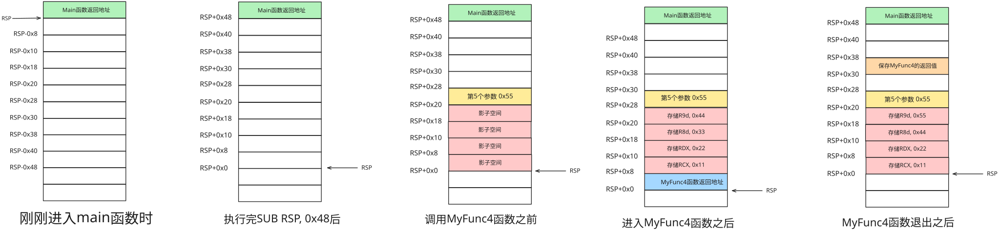

## 易失寄存器和非易失寄存器

x64调用约定中,  寄存器分为两类, 易失寄存器和非易失寄存器.

- 易失寄存器:

  - RAX, RCX, RDX
  - 

  - R8, R9, R10, R11

- 非易失寄存器
  - RBX, RBP, RSP, RSI, RDI
  - R12, R13, R14, R15

对于易失寄存器, 调用函数后, 寄存器中的值可能被更改, 调用者需要自行保存.

对于非易失寄存器, 被调用者需要保证这些寄存器在函数返回后保持原值, 如果在调用期间需要修改, 则必须先保存, 然后在函数返回前恢复.


### x64调用约定

- 函数执行期间, RSP要保证16字节对齐(函数入口、序言和尾声阶段除外).
- 调用者函数要为被调用函数准备32字节的影子空间(Shadow Space)
- 整数和指针参数通过RCX, RDX, R8d, R9d 一次传递, 第五个及五个以上的参数, 从右到左, 依次压栈. 


### 栈结构图

Call进入一个函数后, 首先是将通过寄存器传参的值存入影子空间

- RSP + 0x8 : 存放 RCX
- RSP + 0x10: 存放 RDX
- RSP + 0x18: 存放 R8d
- RSP + 0x20: 存放 R9d


### 影子空间图解


```cpp

int MyFunc4(int a, int b, int c, int d, int e)
{
    int temp = a + b + c + d + e;
    return temp;
}

int main()
{
    int value = MyFunc(0x11, 0x22, 0x33, 0x44, 0x55);
    printf("value = %d\n", value);
    return 0;
}
```

反汇编结果如下:

```assembly

// main函数反汇编
sub     rsp, 0x48
mov     dword ptr ss:[rsp + 0x20], 0x55
mov     r9d, 0x44
mov     r8d, 0x33
mov     edx, 0x22
mov     ecx, 0x11
call    <demo2.int __cdecl MyFunc4(int, int, int, int, int)>
mov     dword ptr ss:[rsp + 0x30], eax
mov     edx, dword ptr ss:[rsp + 0x30]
lea     rcx, qword ptr ds:[<"value = %d\n"...>]
call    <demo2.printf>
xor     eax, eax
add     rsp, 0x48
ret


// MyFunc4反汇编
mov     dword ptr ss:[rsp + 0x20], r9d
mov     dword ptr ss:[rsp + 0x18], r8d
mov     dword ptr ss:[rsp + 0x10], edx
mov     dword ptr ss:[rsp + 0x8], ecx
sub     rsp, 0x18
mov     eax, dword ptr ss:[rsp + 0x28]
mov     ecx, dword ptr ss:[rsp + 0x20]
add     ecx, eax
mov     eax, ecx
add     eax, dword ptr ss:[rsp + 0x30]
add     eax, dword ptr ss:[rsp + 0x38]
add     eax, dword ptr ss:[rsp + 0x40]
mov     dword ptr ss:[rsp], eax
mov     eax, dword ptr ss:[rsp]
add     rsp, 0x18
ret     
```


x64调用约定要求函数执行期间, RSP要保证16字节对齐, 在执行Call指令之前, RSP通常是16字节对齐的, 执行Call指令之后, 会将8字节的返回地址压栈.

也就是说, 刚进入main函数时, RSP不是16字节对齐的. 此时 RSP%16 == 8;

为了满足16字节对齐, 编译器需要将RSP减去N字节, 并且 N 要满足 N%16 == 8; 下面是N满足的一些值:

- 0x8  (8字节)
- 0x18 (24字节)
- 0x28 (40字节)

MSVC编译器通常选择 `Sub RSP, 0x18` 来满足函数执行过程中RSP保持16字节对齐.

main函数反汇编第一行 `SUB RSP, 0x48`,  0x48 = 0x18 + 0x20 + 0x8 + 0x8

- 0x18 字节用来保证 RSP 满足16字节对齐
- 0x20 作为影子空间给MyFunc4使用
- 0x8 用来传递MyFunc4的第5个参数
- 0x8 用来保存MyFunc4执行后的返回结果.





