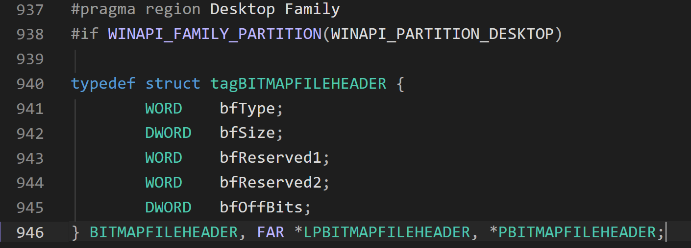

### 1. 数据结构

BMP文件由4部分组成.

- 文件头 File Header
- 信息头 Info Header
- 调色板 Palette
- 像素数据 Pixel Data

### 2. BMPFILEDATA

- bfType: 文件类型标识, 必须为 0x4D42
- bfSize: 整个BMP文件的大小, 单位是字节
- bfReserved1
- bfReserved2
- bfOffBits: 偏移量, 表示从文件开头到实际像素数据开始处的字节数.

